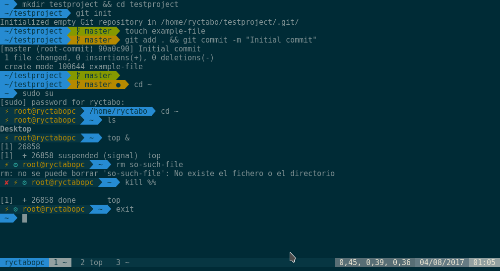

# ryctabo's dotfiles


These are my dotfiles. Take anything you want, but at your own risk.

## How to install?
Requires Git and Zsh. Use tmux 2.9 or later for its configuration. Oh My Zsh
is optional (the configured theme is `half-life`). For Node.js, install
FNM or use the system NVM installation at `/usr/share/nvm/init-nvm.sh`;
FNM takes priority. Bun, Maven and Gradle are optional.

```bash
git clone git@github.com:ryctabo/dotfiles.git ~/.dotfiles
cd ~/.dotfiles
make setup
```

Make must be installed first (for example, `sudo apt-get install make` on
Debian/Ubuntu). `make setup` installs Git, Zsh, tmux, Vim and unzip using
Homebrew, apt-get, dnf or pacman, prepares your personal Git configuration,
and then links the dotfiles. System package managers require root or sudo.
Git is also needed before cloning this repository.

For individual steps:

```bash
make help       # Show available commands
make deps       # Install basic dependencies
make git-local  # Create Git local configuration without overwriting it
make install    # Prepare Git local configuration and link dotfiles
make check      # Check tools and installer syntax
```

The installer links the Zsh, tmux and Git configurations. Existing files
and conflicting links are moved to a unique `~/.dotfiles-backup.*`
directory, whose path is printed. Running it again skips correct links.
Zsh loads the files in `system/` directly from the repository.

See the [system configuration usage guide](system/README.md) for environment
variables, aliases, and examples of the `mk` and `extract` functions.

To restore a backup, remove the corresponding installed symlink and move
the saved file back to its original location. Open a new Zsh session to
load the configuration. The installer does not change your login shell
or install dependencies itself. You can still run `sh ~/.dotfiles/install.sh`
directly. Optional tools such as Oh My Zsh, FNM, Bun, Maven and Gradle are
installed separately.

## Personal Git configuration

The shared Git configuration includes `~/.dotfiles/git/.gitconfig.local`,
which is ignored by Git. Before your first commit, copy
`git/.gitconfig.local.example` to `git/.gitconfig.local` and set your name
and email (the Make targets create this file if missing). Enable GPG signing only when your private key is available.
Keep work-specific includes in this local file as well. If you install
the repository elsewhere, update the include path in `git/.gitconfig`.

Thanks for visiting my dotfiles. :wink:
